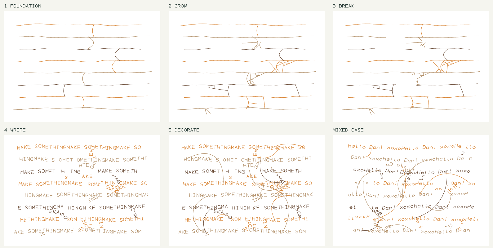

# Perlin Atelier 1.1.1

An offline sketchbook for repeatable pen-plotter artwork, now including a five-stage lettering composition.



## Mac installer

Download **Perlin-Atelier-1.1.1-macOS-Universal-Installer.zip** from the
[latest release](https://github.com/GWB2025/perlin-atelier/releases/latest).
Unzip it, double-click the `.pkg`, and follow Continue → Install. Open
**Perlin Atelier** from Applications afterwards. The installer places the app
at `/Applications/Perlin Atelier.app` and does not change your exported drawings.

The app supports **Apple silicon and Intel Macs, macOS 12 or later**. It runs
in its own window and uses native Save dialogues for SVG and PNG. No separate
Python, Node.js, browser or internet connection is needed to run it.

This is an ad-hoc-signed app in an unsigned, non-notarised installer. If macOS
blocks the initial opening, follow [Apple's per-app approval guidance](https://support.apple.com/en-gb/102445)
for a download you trust. Do not disable system-wide security protections.
See [installation instructions](packaging/READ-ME-FIRST.txt).

This repository is initially private. No open-source licence has been selected.

## Start

For the browser edition, open `index.html` with its adjacent JavaScript and CSS files, or build and open `dist/Perlin_Atelier.html` in a modern browser. No account or internet connection is needed.

Choose **Letter garden**, enter your text and adjust the controls. Click **Foundation**, **Grow**, **Break**, **Write** and **Decorate** above the preview to follow the same seeded design. **Decorate** is the finished composition.

1. Foundation creates 3–24 row bands, with neighbouring lines and curved vertical links. Density controls the number of lines in each band.
2. Grow sprouts branches through 1–6 rounds, stopping each branch at a crossing.
3. Break removes real line segments using Perlin-distorted rectangular boundaries. The cut-outs are geometry, not SVG clipping masks.
4. Write replaces the surviving skeleton with monoline letters, plus sparse lettering inside the breaks. Letters are separate pen strokes, not outlined type or SVG text.
5. Decorate adds curved cables between selected letters. The cable control is a maximum; fewer may fit a sparse design.

Construction guides show the cut-out regions and, from Write onwards, the underlying skeleton. They appear only in the preview and are excluded from both exports. Changing the preview stage does not regenerate the composition.

## Text and controls

**Repeat my text** follows your character sequence across the available lines, starting again at the end. It is decorative composition rather than paragraph typesetting: letters follow different branches and are omitted where they cannot fit. **Shuffle my characters** chooses randomly from your text. The remaining modes generate mixed-case English letters, digits or common symbols. Choose Monoline or Slanted lettering.

The original stroke alphabet supports English upper- and lower-case letters, digits and common punctuation. Accents are reduced to plain letters, typographic quotes become straight quotes and dashes become hyphens. Unsupported characters, such as emoji, become `?` with a visible notice. It does not provide arbitrary Unicode fonts or captured handwriting. Blank custom text produces no lettering.

Letter height is the capital height in millimetres; lower-case descenders extend below the baseline. Letter spacing controls the advance between characters. Letters that would leave the paper margin are skipped. If too few letters appear, reduce the letter height, reduce the row count or increase the paper size.

Distortion and noise scale affect the foundation and branches; scale also changes the cut-out edges. Density controls the number of foundation rails and branching attempts. Octaves add finer noise to the foundation. Line detail applies to the four original abstract styles; it has no effect on Letter garden.

The same seed and settings produce the same artwork. Use Surprise for another seed. The SVG metadata records all settings. Reset restores the postcard Letter garden preset. The four earlier styles and their five presets remain available.

## Export and plot

- **Download SVG** exports the selected stage, labelled in the filename. Select Decorate for the finished lettering.
- SVGs use physical millimetre dimensions, plain vector paths, no fills and separate Inkscape-compatible layers for each pen colour.
- **Export PNG** saves the same clean artwork on a white background, without construction guides. Use SVG for plotting.
- The default postcard is 148 × 105 mm, landscape, with a 7 mm margin. Import into SVG Plotter at **actual size**. Place the postcard using your existing carrier/registration workflow.
- The Kyoto earth palette approximates orange, light brown and dark brown inks. Preview colours are not calibrated measurements. Start with Micron black for a single-pen trial.
- This application generates artwork; it does not connect to or control the plotter. Physical plotting has not been tested as part of this release.

## Inspiration and attribution

The five-stage idea follows Dan Catt's [newsletter #099, 29 October 2026](https://newsletter.revdancatt.com/p/099-sweary-plots-doom-maps-postcards). This is an original interpretation of the published description, not his source code, exact algorithm or captured handwriting. The lettering alphabet was drawn specifically for this app. Perlin noise and fractal Brownian motion also drive the four earlier abstract styles.

## Source and checks

No runtime dependencies. JavaScript modules work in the browser and can be required by Node for tests.

```sh
node --test tests/*.test.js
python3 -m unittest discover -s tests -p 'test_*.py'
node build.js
```

To build the Mac app and installer, use a development Mac with Apple's Command
Line Tools, Node.js and Python 3.9 or later:

```sh
python3 packaging/build_mac.py
python3 packaging/build_installer.py \
  --app 'dist/Perlin Atelier.app' \
  --output dist/Perlin-Atelier-1.1.1-macOS-Universal-Installer.pkg
```

The second command creates both the PKG and ZIP and verifies the expanded
payload. It does not install the app. The installer uses a fixed Applications
destination, strict bundle identification and version checking, and has no
installation scripts. Build products are ignored by Git.

`noise.js`: seeded noise; `font.js`: stroke alphabet; `lettering.js`: geometric stages; `art.js`: SVG construction and original styles; `app.js`: interface; `downloads.js`: browser/native export; `native/main.m`: the AppKit/WebKit shell; `packaging/`: Mac builders; `build.js`: standalone packaging and ten samples.

The 20 JavaScript and 4 Python tests cover geometry, repeatability, text, SVG layers, interface wiring, export success/cancellation/errors, and installer policy. The compiled native self-test also checks bundled resources, export bytes and filename validation. See [validation notes](docs/VALIDATION.md) for the checks and their limits.
